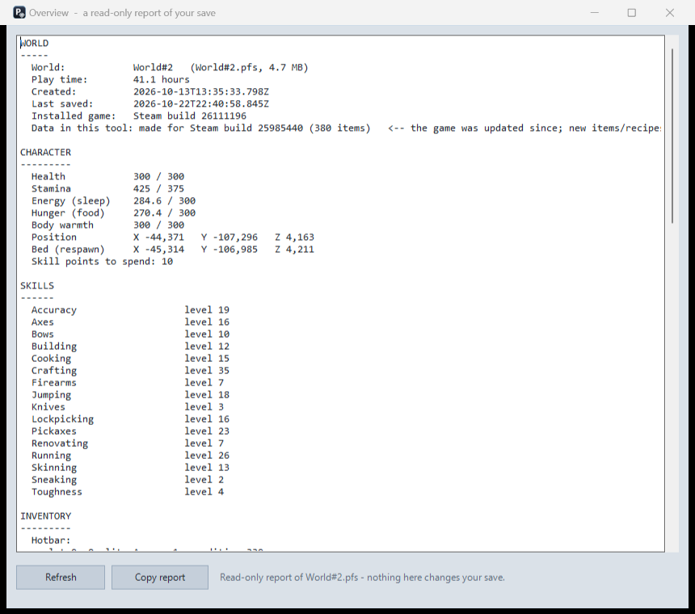
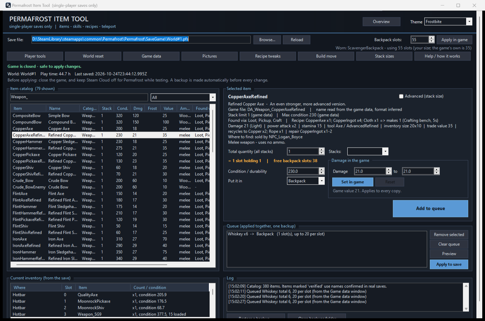
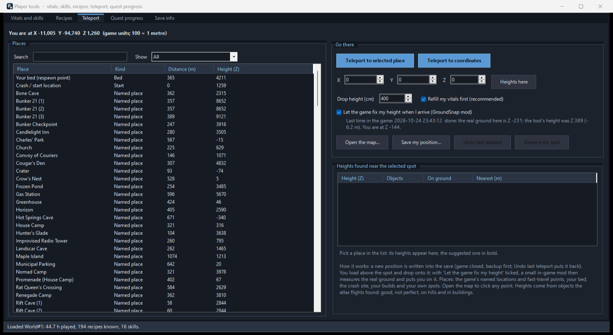
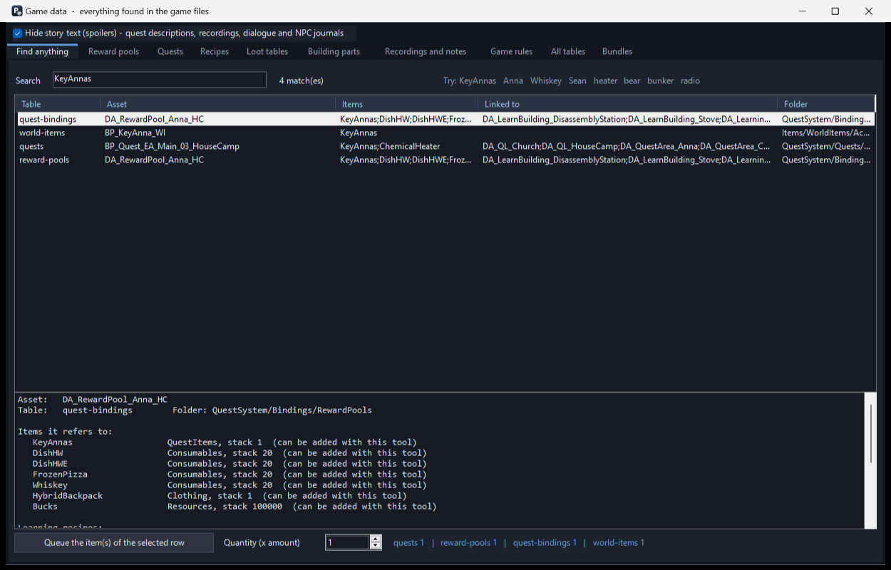
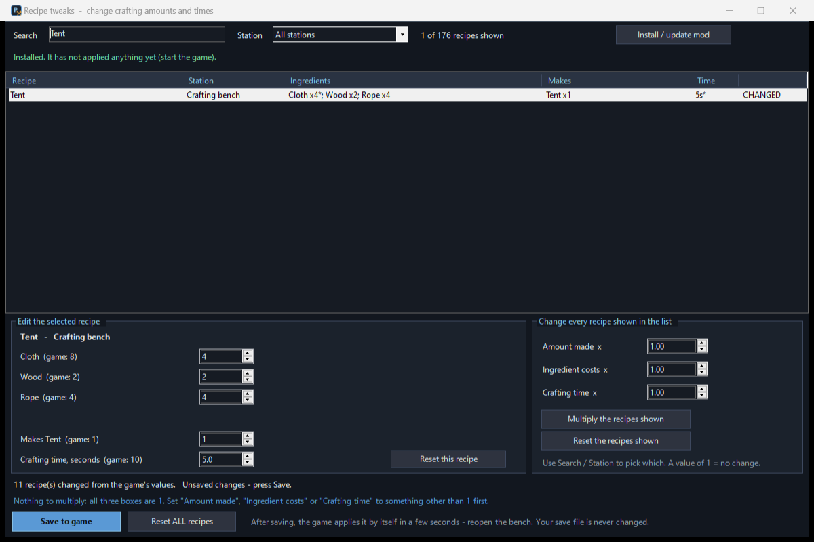
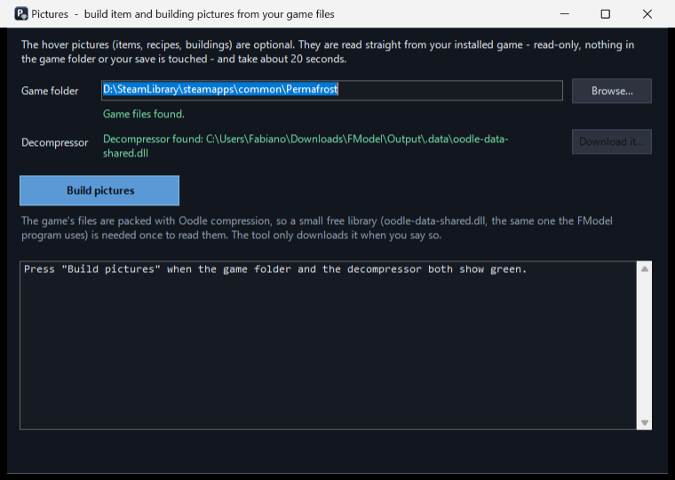

# Permafrost Item Tool


A Windows tool for **single-player** [Permafrost](https://store.steampowered.com/app/2254990/) saves. Add items to your backpack, fix a stuck quest, teleport, learn recipes, set skills, put harvested trees / ores / loot back, change crafting recipes, and move buildings you placed. It **finds your saves by itself** and ships with everything it needs: no exporting, no mappings, no setup.



> **Unofficial fan tool, not affiliated with the developers or publisher of Permafrost.** Single-player only. Editing a save can corrupt it. The tool makes a backup before every change and checks its own work, but **keep your own copy of your save too**, and always **close the game before you apply anything**.

---

## Contents

1. [Quick start](#1-quick-start)
2. [Before you change anything: the safety rules](#2-before-you-change-anything-the-safety-rules)
3. [Installing, step by step](#3-installing-step-by-step)
4. [A tour of the window](#4-a-tour-of-the-window)
5. [Everyday tasks: how do I...?](#5-everyday-tasks-how-do-i)
6. [Reference: the main window](#6-reference-the-main-window-adding-items)
7. [Reference: Overview](#7-reference-overview)
8. [Reference: Player tools](#8-reference-player-tools)
9. [Reference: Game data](#9-reference-game-data)
10. [Reference: Recipe tweaks (in-game mod)](#10-reference-recipe-tweaks-in-game-mod)
11. [Reference: World reset](#11-reference-world-reset)
12. [Reference: Build move (in-game mod)](#12-reference-build-move-in-game-mod)
13. [Reference: Pictures](#13-reference-pictures)
14. [Backups, restoring, and Steam Cloud](#14-backups-restoring-and-steam-cloud)
15. [Files and settings](#15-files-and-settings)
16. [Installing UE4SS (only for the in-game mods)](#16-installing-ue4ss-only-for-the-in-game-mods)
17. [After a game update](#17-after-a-game-update)
18. [Advanced: rebuild the data from your own game files](#18-advanced-rebuild-the-data-from-your-own-game-files)
19. [Troubleshooting and FAQ](#19-troubleshooting-and-faq)
20. [For developers: one working copy, tests, releases](#20-for-developers-one-working-copy-tests-releases)
21. [How it works / repository layout](#21-how-it-works--repository-layout)
22. [Legal](#22-legal)

---

## 1. Quick start

1. **Download** the latest ZIP from the [Releases page](https://github.com/treefitty5/permafrost-item-tool/releases/latest) and unzip it somewhere you own, for example `C:\Tools\PermafrostItemTool`. (Not inside the game folder, and not in a folder that Windows protects, such as `Program Files`.)
2. **Close Permafrost completely.**
3. Double-click **`Run Permafrost Item Tool.cmd`**.
   - It needs **PowerShell 7**, a free Microsoft download. If it is missing, the launcher offers to install it for you (press **Y**).
   - If Windows shows *"Windows protected your PC"*, click **More info → Run anyway**. The tool is plain text scripts, not a signed program; you can open any `.ps1` or `.cmd` file in Notepad and read exactly what it does.
4. The tool **finds your saves** and opens the most recently played world. Click **Browse...** to choose another world, and **Overview...** to see everything it can read from the save.

Optional but recommended: a bar near the top offers **Build pictures now**. It builds the item pictures from your own installed game (about 20 seconds, once). See [Pictures](#13-reference-pictures).



## 2. Before you change anything: the safety rules

* **Single-player worlds only.** Never use it on a multiplayer world.
* **Close the game first.** In the game, save, then quit completely. The tool shows *"Game is closed - safe to apply changes"* in green; if the game is running it shows red and refuses to apply anything, because a running game would overwrite your edit.
* **Keep Steam Cloud off for Permafrost while you edit** (see [section 14](#14-backups-restoring-and-steam-cloud)). Otherwise Steam can put the old save back.
* **Every change is backed up automatically** (`Backups` folder inside the tool folder) and **checked before it replaces your save**. If a check fails, the tool puts the original back and tells you.
* **Nothing is written until you press an Apply / Save button.** Previews, the Overview, the Game data browser and the catalog never change your save.
* **Recipe tweaks and Build move work inside the running game** and never touch your save file.
* The tool only edits what each feature names (inventory entries, player values, learned recipes, position, world records). It refuses to write if its own checks fail rather than guessing.
* **Keep a copy of your save yourself** before big changes: the `.pfs` files live in `...\steamapps\common\Permafrost\Permafrost\SaveGame`.

## 3. Installing, step by step

**What you need**

| What | Why | Where |
|---|---|---|
| Windows 10 or 11 | the window uses Windows Forms | |
| **PowerShell 7** (`pwsh`) | the tool is written in PowerShell 7 | the launcher installs it for you (`winget install Microsoft.PowerShell`), or <https://aka.ms/powershell> |
| **Permafrost** (Steam) | the game and its save files | |

Nothing else for the main window. **UE4SS** is only needed for the in-game mods ([section 16](#16-installing-ue4ss-only-for-the-in-game-mods)); **FModel** only if you want to rebuild the data yourself ([section 18](#18-advanced-rebuild-the-data-from-your-own-game-files)). There is no installer and no `.exe`: you do not need Python, a .NET SDK or a compiler.

**Step by step**

1. **Download the ZIP** from the [Releases page](https://github.com/treefitty5/permafrost-item-tool/releases/latest). The ZIP contains one folder, `PermafrostItemTool`. (The green **Code → Download ZIP** button on the repository page also works.)
2. **Unzip it** to a folder you own, such as `C:\Tools\PermafrostItemTool`.
3. **Close the game**, then double-click **`Run Permafrost Item Tool.cmd`**.
   * *"PowerShell 7 was not found"*: press **Y** to let the launcher install it with Windows' own `winget` (about 100 MB, it does not replace Windows PowerShell), or install it from <https://aka.ms/powershell> and start the launcher again.
   * *"Windows protected your PC"*: **More info → Run anyway**.
   * If scripts are blocked, open PowerShell 7 in the folder and run `Get-ChildItem -Recurse | Unblock-File` once. The launcher already starts the tool with `-ExecutionPolicy Bypass`.
   * Antivirus programs sometimes dislike unsigned scripts. The source is all here to read; nothing is downloaded behind your back (the one optional download, the Oodle decompressor, asks first).
4. **The window opens** (no black console window) and picks your most recently saved world. The line under the save box shows the world, play time and when it was last saved.
5. **Check the world.** If it is not the one you want, click **Browse...**: it lists every Permafrost save found on this PC with hours played and last-saved time. Your choice is remembered.
6. **Click Overview...** for a read-only report of the save. If the numbers match your game, everything is working.
7. **Build the pictures** (optional): press **Build pictures now** in the bar under the save box ([section 13](#13-reference-pictures)).

To start the tool later, double-click the same `.cmd` file (make a desktop shortcut to it if you like).

## 4. A tour of the window

The window opens maximized and follows your window size. **F11** gives true full screen (F11 or Esc to leave).

| Area | What it is |
|---|---|
| **Banner** (top) | **Overview...** and **Pictures...** buttons and the **Theme** box (three colour themes, remembered). |
| **Save file row** | The `.pfs` save being edited. **Browse...** lists all worlds, **Reload** re-reads the save, then buttons for the extra windows: **Build move...**, **World reset...**, **Recipe tweaks...**, **Player tools...**, **Game data...**, **Help / how it works**. |
| **Status lines** | Green/red game status, the world, play time and last-saved time, and the backpack size ("Worn: ScavengerBackpack - using 35 slots"). |
| **Item catalog** (left) | Every item in the game, searchable and sortable. |
| **Selected item** (right) | Details and the quantity / condition boxes for the item you clicked. |
| **Queue** (right) | Items waiting to be added, with **Preview** and **Apply to save**. |
| **Current inventory** (bottom left) | What your hotbar and backpack hold right now. |
| **Log** (bottom right) | A running record of everything the tool did, plus **Restore a backup...** and **Open backups folder**. |

The window refreshes by itself when the save changes (for example after you play), so it always shows your current backpack.

## 5. Everyday tasks: how do I...?

**...add items to my backpack or hotbar?**
Close the game → search the catalog (by name or id) → click the item → set the quantity → **Add to queue** → repeat → **Preview** → **Apply to save** → start the game. Details in [section 6](#6-reference-the-main-window-adding-items).

**...see what's in my save without changing anything?**
**Overview...** (top right) lists world, character, skills, inventory, recipes, quests, buildings, explored area, companion and backups. **Copy report** puts it on the clipboard, handy when asking for help.

**...change health, stamina, skills or skill points?**
**Player tools... → Vitals and skills.** Edit the numbers, press **Apply changes to save** ([section 8](#8-reference-player-tools)).

**...learn recipes I haven't found yet?**
**Player tools... → Recipes.** Tick the ones you want and press **Learn ticked recipes**.

**...teleport somewhere?**
**Player tools... → Teleport.** Pick your bed, the crash site or anything you built, or type X / Y / Z coordinates from the in-game map. The new position is written into the save; you appear there when you load. If you appear underground or inside rock, teleport again with a higher *Drop height* (about 500).

**...find out what a stuck quest is waiting for?**
**Game data... → Quests.** Pick the quest: its states and tasks are listed, and **>>** marks where your save is. The *Items this step needs* box lists what the current step asks for, and a button queues exactly those items. For a missing key or quest item, search it under **Find anything** (for example `KeyAnnas`) and queue it from there.

**...harvest the trees, ores, bushes and loot I already used?**
**World reset...** ([section 11](#11-reference-world-reset)). Try a radius of 150 m around you first. It restores from your earlier backups and your other worlds, so keep the `Backups` folder.

**...make a crafting recipe cheaper, faster, or give more?**
**Recipe tweaks...** ([section 10](#10-reference-recipe-tweaks-in-game-mod)). Needs UE4SS. Works while the game runs.

**...move a building I placed?**
**Build move...** ([section 12](#12-reference-build-move-in-game-mod)). Needs UE4SS. In the game: look at it, press **Q**, choose **Move**.

**...undo something?**
**Restore a backup...** (bottom right of the main window). Pick the backup; your current save is kept too. See [section 14](#14-backups-restoring-and-steam-cloud).

**...see item pictures when I hover?**
Click **Build pictures now** (or **Pictures...** in the banner) once ([section 13](#13-reference-pictures)).

**...switch to another world?**
**Browse...** and pick it. World reset also has its own World box.

## 6. Reference: the main window (adding items)

**Item catalog** (all items found in the game's data). Type in the search box or pick a category; click a column header to sort. Everything comes from the game's own data unless it says otherwise.

| Column | Meaning |
|---|---|
| **Item** | The id the save uses (you can search by it). |
| **Name** | The in-game name. |
| **Category** | Resources, Consumables, Weapons, Clothing, Valuables, Accessories, Projectiles, QuestItems, Traps, Holdables. |
| **Stack** | How many fit in one slot. Items whose data has no stack setting stack as 1. |
| **Cond.** | The item's top condition / durability (building parts use their max health). Blank = none exists. A "~" marks the few quest items that have no value in the data. |
| **Dmg** | Weapon damage per hit (shots for guns); "melee" = none. |
| **Frost** | Cold protection of clothing. |
| **Value** | Trade value. |
| **Ammo** | Which ammo a gun uses, or how many weapons use an ammo type ("no gun" = none found). |
| **Found via** | Which game files link the item: *Loot* (loot tables/containers), *Pickup* (a world pickup exists), *Craft* (a crafting recipe), *Trader*, *Quest* (reward pool or quest), *Animal*. It says where it is linked, not how likely it is. "-" = no link found (likely unreleased). |
| **Status** | *Verified* = the exact name has been seen in real saves (known to work). *Game data* = name read from the game files (worked every time so far, never seen in a save). *Name unsure* (red) = several names were possible; the game may ignore it. |

**Selected item** (click an item). Under the name you see its description, stack limit, max condition, damage and similar numbers, the recipe (ingredients, time, station), and **where to find it** with the chance per container opening, worked out from the loot weights (for example "2.9% Military_Car_01 +5 [Container]" is about a 3% chance each time one of those is opened; "sold by" lists traders).

* **Total quantity** - how many items to add in total.
* **Stacks** - pick 1-10 stacks and the total fills in (stacks x items per slot); the other way round works too. *Advanced (stack size)* shows more boxes for more than 10 stacks and for changing the items-per-slot.
* **Free slots line** - shows how many slots are free (counting what is already in the queue). If the item will not fit it says **NOT ENOUGH SPACE** in red; **Preview** and **Apply** then refuse to run until it fits (free space in the game, add less, or use the hotbar).
* **Condition** - wear value for weapons, clothing and tools (greyed out for items that have none). **Rounds loaded** - only for firearms.
* **Put it in** - **Backpack** or **Hotbar**; the tool uses the first free slots.
* **Add to queue** (or double-click an item) puts it on the list. Nothing is written yet.
* **Backpack slots** (top right) - how many slots your worn backpack has (the line under it says where the number comes from). Type a different number and press **Apply in game** to change the size of that backpack: see [Backpack size](#backpack-size-in-game-mod) below. **Add items** counts the size you set.

**Queue.** *Remove selected* and *Clear queue* edit the list. **Preview** shows exactly which slots would be used plus any warnings, and writes nothing.

**What Apply to save does, step by step**

1. Checks the game is closed.
2. Dry run: works out the exact free slots; stops if there is not enough room.
3. Shows any **CAUTION** warnings; you must answer Yes (the default answer is No).
4. Shows a final confirmation listing the exact slots.
5. Makes a backup of your save (in `Backups`).
6. Edits all three copies of your inventory inside the save and checks they agree.
7. Re-reads the finished file; if anything is off it puts your original back.
8. Refreshes the file's modified time so Steam sees it as the newest copy.

**Warnings you may see**

| Warning | Meaning |
|---|---|
| Best guess name | The item name was ambiguous; the game may simply ignore it. |
| Raised stack size | Bigger than anything seen in real saves; the game may cap or mishandle it. |
| Condition too high | Above the usual value; may exceed the item's real maximum. |
| Quest item | Adding it does **not** complete or advance any quest step. |
| Not enough room | Free some backpack/hotbar space in the game first. |
| Game is running | Save and close the game, then try again. |

If a step fails, the message says whether your save was left untouched or the original was put back. An unknown item name is silently ignored by the game (the item just does not appear).

## 7. Reference: Overview

**Overview...** (banner, top right) is a **read-only** report built from the save. Sections:

* **World** - world name and file, play time, created / last saved, the installed game's Steam build, and the build the shipped data was made for (with a warning if the game was updated since).
* **Character** - health, stamina, energy, hunger, body warmth, position, bed, unspent skill points.
* **Skills** - the 16 skills with their levels.
* **Inventory** - the hotbar slot by slot, and the backpack with totals per item and slots used out of the backpack size.
* **Recipes** - how many you know out of the game's total.
* **Quests** - started and active quests (in-game names), unlocked regions.
* **Buildings you placed** - how many parts, grouped by type.
* **Explored world** - map areas loaded at least once, objects saved in them, containers found (opened / still unopened), objects used up.
* **Companion (dog)** - state, bond and carried items.
* **Backups of this world** - how many and the newest.

**Refresh** re-reads the save; **Copy report** copies the text.

## 8. Reference: Player tools



**Player tools...** opens maximized. It works on the save selected in the main window. Anything that changes the save needs the game closed, asks for confirmation, makes a backup first and re-checks the result.

| Tab | What it does |
|---|---|
| **Vitals and skills** | Current and maximum health / stamina / energy / hunger / body warmth, unspent skill points, and the level of each of the 16 skills (or all at once). The list shows each skill's maximum level and the benefit per level from the game data, and levels above the cap are stopped. Nothing is written until you press **Apply changes to save**; only the values you changed are written. XP needed per level = 10 x level^1.5 (matches real saves). Levels above anything seen in saves (the highest is 29) are flagged as untested. |
| **Recipes** | All recipes in the game's files (item recipes and building recipes), marked learned / not learned. Tick the ones you want and press **Learn ticked recipes**. Hover a recipe to see its picture and details: build cost, requirements and description for building recipes; ingredients, what it makes, where and how long for item recipes (pictures need [section 13](#13-reference-pictures)). |
| **Teleport** | Moves you to your bed, the crash site, or any workbench, campfire or other part you built. You load above the spot (**Drop height**, default 150 cm; use about 500 if a spot is inside rock or a hillside) and drop onto it. **Coordinates:** the game's own named locations have no coordinates in the data, so instead open the in-game map and read X / Y / Z at its lower left (**it is your own position, not the cursor**), type them in the row above the list and press **Teleport to coordinates**. If the game spawns you at the start instead, the spot was not accepted (it happened with spots in mid-air or inside rock): try again with a higher drop height or a spot you stood on yourself. Works on any world: pick it in the main window first. |
| **Quest progress** | **Read only.** Every quest in your save with its in-game name, what the game says about your current step and the next task; green = the game marks that state as an end state. Also task counters, rewards already claimed, and the journal. Quests are deliberately not editable. Story text is hidden behind the spoiler guard (on by default). |
| **Save info** | Summary of the save: world, play time, position, skills, vitals, everything you built. |

## 9. Reference: Game data



**Game data...** is a browser over every table the tool ships. Select a row for its details; most tabs can queue the items they mention.

| Tab | What it shows |
|---|---|
| **Find anything** | Type a name (`KeyAnnas`, `Anna`, `Whiskey`, `heater`, `bunker`...) and see every quest, reward pool, loot config, NPC, recipe or world item that mentions it. The button queues its items. |
| **Reward pools** | What each quest reward group pays out, with exact amounts and which recipes it teaches. Queue a group's items. |
| **Quests** | All 125 quests: description, every state, the tasks that lead from one state to the next (talk to, find, build, craft...), events, and a `>>` marker where **your** save is. **Quest helper:** *Items this step needs* lists what your current step asks for (an item to find or hand over, ingredients for a craft task, a reward group to collect); the button below queues exactly those items. |
| **Recipes** | Crafting recipes (ingredients, amounts, what they make, time, station) and learning recipes (what they teach, how they are learned, cost, which rewards hand them out), with *learned* status from your save. **Craft list:** pick a crafting recipe, set the number of crafts, press the button, and all ingredients are queued. |
| **Loot tables** | Every loot list: items with spawn weight and amount range, guaranteed loot, which containers / NPCs use it. |
| **Building parts** | Cost, health, refund, repair cost and requirements of everything you can build. |
| **Recordings and notes** | Story text of recordings, radio messages and notes. *Not part of the shipped data pack* (see [section 22](#22-legal)); it fills in if you rebuild the data from your own game files. |
| **Game rules** | Pick a table: gameplay effects (what food, medicine, wounds and cold do), status effects, difficulty presets (with a *Difficulty compare* table; "(default)" means the preset does not store that setting), animals, NPCs, skills, attributes, plants, destructibles, random encounters, fast travel, achievements, world locations. |
| **All tables** | Every table built from the game files (loot, containers, NPCs, animals, locations, building parts...). |
| **Bundles** | One-click groups: all quest items, a full stack of every ammo, ammo for the weapons you carry now, or everything one reward pool can give. They go into the Queue; you still Preview / Apply as usual. |

The **Hide story text (spoilers)** box at the top hides quest descriptions, recordings, dialogue and NPC journals until you untick it (the same box is in Player tools > Quest progress). Task lists, items and numbers stay visible.

Not stored in the game files: how often a container is found in the world, and anything the game decides at run time.

## 10. Reference: Recipe tweaks (in-game mod)



**Recipe tweaks...** edits crafting recipes: ingredient amounts, how many a craft makes, and crafting time. It works through a small mod for UE4SS ([section 16](#16-installing-ue4ss-only-for-the-in-game-mods)). **Your save file is never changed, so this window can be used while the game is running.**

1. Click **Install / update mod** once. It copies the mod into `...\ue4ss\Mods\RecipeTweaks` and adds `RecipeTweaks : 1` to `Mods\mods.txt` (a backup of `mods.txt` is made first). **Restart the game** after installing or updating: UE4SS loads mods at start-up only.
2. Pick a recipe and edit its boxes, or use the **Change every recipe shown** boxes with **Multiply the recipes shown** (filter with Search / Station first, for example `ammo` and *Amount made x 5*). That button only changes the numbers in the window.
3. Press **Save to game**.
4. In the game, a saved change applies by itself within a few seconds. **Close and reopen the bench** to see it (an open bench keeps the numbers it showed when it opened). **F8** re-applies by hand.
5. To undo: **Reset ALL recipes**, then **Save to game**. Or set `RecipeTweaks : 0` in `mods.txt`.

You can edit recipes you have not learned yet; the values are there when you learn them. Everything the mod does is written to `ue4ss\UE4SS.log` (search for `[RecipeTweaks]`) and to `status.txt` in the mod folder.

## 11. Reference: World reset

The game never respawns trees, boulders, picked-up items or container loot. **World reset...** puts them back by editing your save. **Close the game first.** A backup is made before every change, and the result is checked before it replaces the save.

1. Pick the **World**. The box lists every `.pfs` in your SaveGame folder; under it you see the hours played, when it was last saved and how many backups that world has.
2. Tick what to put back:
   * trees you have chopped down;
   * boulders and ores (rock, coal, flint, iron, copper, sulfur, gold, moon rock);
   * items that lay in the world (scrap, oil, plastic, food, rock shards, scavengable bushes...);
   * loot in containers (cars, cabinets, crates, corpses, trash cans...);
   * bushes and other generated plants / rocks you have harvested;
   * optionally, other breakables (pallets, rubble, trash piles, furniture).

   *Leave containers alone that still hold items* keeps containers you only half emptied.
3. Optionally limit it to **N metres around where you stand in the save** (your position at the last save; 0 = the whole world). **Try 150 first**, load the game, check, then do the rest.
4. **Preview** shows how many of each would be put back and what is left alone. **Reset the world now...** runs its own preview, asks you to confirm, makes the backup, writes the change and verifies it. You do not have to press Preview first.
5. Undo with **Restore a backup...** in the main window.

**A brand-new world with no history yet?** The tool ships a **map of untouched objects** (`catalog\pristine-world.bin`, 175 KB): every boulder, ore, breakable and world item as the game places it, recorded by flying over the whole playable map in a world nobody had played. World reset uses it as its oldest history, so even a world with no backups at all gets its mined boulders and ores back, and picked-up items too (an item is only restored from it when your save lists it as used up, because items spawn at random per world). Tested on worlds that were not used to build it, it has 98-99% of the ores, 99% of the breakables and 94-98% of the world items; the rest are objects that get a different random id in every world, which no map can know. Your own backups and your other worlds always win over it. The first time the tool opens a world that has no backup it also saves a **starting snapshot** into `Backups` (`yyyymmdd-hhmmss_BASELINE_World#N.pfs`; a read-only copy of your save, skipped while the game is running and tried again later). The snapshot is what brings back **container loot** exactly as it was and anything the shipped map does not list, so **open the tool early in a new world, before you start mining and looting.** Felled trees, partly mined boulders, harvested bushes and emptied containers can be put back with no history at all.

**How it works.** The save has a record for every object of every area you have visited; a destroyed or picked-up object simply has no record any more. Felled trees are removed from the record (they stand again); partly mined boulders go back to full health; destroyed boulders and picked-up items are put back from your **earlier backups** (so keep the `Backups` folder), **from the saves of your other worlds on the same map**, **and, last, from the shipped map of untouched objects**: the same object has the same id in every world, so what another world still has untouched can be put back (ores, breakables and items only; container loot is rolled per world). A fresh world that you teleport around with *Player tools > Teleport* is a clean source for any area you care about. Looted containers get their original loot back from a backup, or the loot of another unopened container with the same loot table; if none is left in your world, a real roll from the shipped loot pool (`catalog\loot-pool.json`, about 1,100 real rolls over 33 loot groups) is used as the last resort. Quest items and keys are never re-rolled.

Two more things the game keeps in the save are handled too:

1. One **list of used-up objects** (`[rGUID>...` entries) grows with everything you destroy or collect. The game drops a restored object again while it is still on that list, so the reset takes every object it puts back off the list (without this, restored ores simply vanished when the area loaded).
2. **Bushes and other generated plants / rocks** are not records: each harvested one is a single entry (its position) in a list on the game's PCG actors, and the reset removes the entries inside your radius so they grow back. Checked in the game with a bush; the other kinds in those lists were not identified one by one, so try a small radius first.

**Solar panels:** no save ever records an unopened panel, so their loot is rolled from the game's own table (one pick: wire, components, electrical parts, rarely metal junk). Known game issue (version 0.44.3, reproduced with every mod off and in a brand-new world): panels show no "Press F" prompt, so restored panel loot cannot be opened for now; everything else works. **Not covered:** containers with no loot sample at all.

## 12. Reference: Build move (in-game mod)

**Build move...** installs a small UE4SS mod that lets you pick up a building you placed and put it somewhere else, without rebuilding it. Click it once (needs UE4SS, [section 16](#16-installing-ue4ss-only-for-the-in-game-mods)): it copies the mod into `...\ue4ss\Mods\BuildMove` and adds `BuildMove : 1` to `mods.txt` (a backup is made). **Restart the game** after installing or updating. The tool does not edit your save for this: the game saves the new position itself.

* **Move from the wheel:** look at a placed part (furniture, storage chest, barrel, workbench, lamp, brazier, bed), press **Q** and choose **Move** (the mod puts it in the wheel's empty padlock slot, between Deconstruction and Call dog). The part follows your crosshair.
* **Put it down:** **left click**; choosing Move again or pressing **F7** also puts it down. F7 starts a move without opening the wheel.
* **The same object is moved:** health, contents and variation stay, and no materials are used or refunded.
* **No collision check, on purpose:** you can put a part on top of another one, stack storage (chests on chests, barrels on barrels) and put storage on walls. If a part ends up inside a wall or the ground, pick it up again with Move.
* **Not tested yet:** Page Up / Page Down (turn the held part 15 degrees), F6 (cancel: the part jumps back) and the refusal of structural pieces (walls, floors, foundations, roofs, doors, beams, stairs).
* **Log:** `ue4ss\Mods\BuildMove\BuildMove.log` lists every step the mod took (also in `UE4SS.log`, search `[BuildMove]`). Switch it off with `BuildMove : 0` in `mods.txt`.

### Backpack size (in-game mod)

The size of a backpack is not stored in your save: the game builds it from its item data when the world loads. The **Backpack slots** box (top right of the main window) can change that number for the backpack you are wearing.

1. Type the size you want (5 to 200; the largest backpack in the game is 50) and press **Apply in game**.
2. The first time, the tool offers to install a small UE4SS mod (**BackpackSlots**, [section 16](#16-installing-ue4ss-only-for-the-in-game-mods)) into the game's `Mods` folder. It only changes numbers inside the running game and never touches your save.
3. **Start the game.** The mod applies your size from the moment the game starts, before your save loads, so the backpack is already the new size when you load in. If the game is already running, take the backpack off and put it back on (drag it to the hotbar and back); the change is picked up then.
4. To undo it, type the game's own size (shown under the box) and press **Apply in game** again, or switch the mod off (`BackpackSlots : 0` in `Mods\mods.txt`).

What the tool checks: it refuses a size that would leave an item outside the backpack (for example 20 slots while something sits in slot 24; nothing is changed and a message says which slot is in the way), shows a **red warning under the box** whenever an item already sits above the size the tool counts (for example because the mod was switched off or removed), asks before sizes above 60 (untested), and counts your size in **Add items** only while the mod is installed and switched on. **If you remove the mod or lower the size later, move your items into the lower slots first.** Each backpack keeps its own setting, so a different backpack you wear later uses its own (or the game's) size. Tested in the game: raising a Casual backpack from 15 to 25 slots, then back.
## 13. Reference: Pictures



The hover pictures (items, recipes, buildings) are optional and are **not included** in the download: they are the game's own artwork. The tool builds them from **your installed game** instead:

1. Click **Build pictures now** in the bar under the save box (shown while there are no pictures), or **Pictures...** in the banner at any time. The window finds your game folder from your save; use **Browse...** if it cannot.
2. The game's files are packed with Oodle compression, so a small free library, `oodle-data-shared.dll` (about 1 MB, the same file the FModel program uses), is needed once. If it is not found, the window shows **Download it...** and tells you where it comes from before it downloads anything. If you already use FModel, the tool finds FModel's copy.
3. Press **Build pictures**. It takes about 20 seconds and writes small PNGs to the `icons\` folder next to the tool (item pictures and building pictures). Nothing in the game folder or your save is touched.
4. Hold the mouse over an item (catalog, inventory, queue) or a recipe (Player tools > Recipes) to see its picture and details. Reopen Player tools to see the recipe pictures.

The bar has **Not now** (hide it until the next start) and **Don't ask again** (writes `pictures.json`; delete that file to bring the bar back). A few items have no texture in the game files (for example `MetropolisMask`); they show text only, and `icons-missing.txt` lists them.

**After a game update**, run **Pictures...** again to pick up new items.

## 14. Backups, restoring, and Steam Cloud

**Backups.** Before every change the tool copies your save into the `Backups` folder inside the tool folder, named `yyyymmdd-hhmmss_World#N.pfs` (date, time, world). The first time the tool opens a world that has no backup it also saves a **starting snapshot**, named `yyyymmdd-hhmmss_BASELINE_World#N.pfs` (see [section 11](#11-reference-world-reset)). Every window that changes the save uses the same folder. **Restore a backup...** (main window) puts one back; your current save is kept next to it as `..._BEFORE-RESTORE_...`. **Open backups folder** opens the folder. Backups can be big (each is a full save, 1-5 MB); delete old ones if you need space, but **keep some**: World reset uses them as its history to restore ores and picked-up items.

**Steam Cloud.** Steam syncs the game's save folder. If it syncs an **old** copy over your edited save, the edit is lost. Safest: leave Steam Cloud **off** for Permafrost while you use this tool: Steam Library → right-click Permafrost → Properties → General → turn off *Keep game saves in the Steam Cloud*. If you turn it back on later, do it **after** your edits; at the next launch Steam may show a conflict - always choose to keep / upload the **local (newer)** files, never "download from cloud". The tool refreshes the save's modified time after every apply and restore so it counts as the newest copy.

**Saves from a newer game version** may not open in an older one. Keep a copy of your save from before a game update if you might go back.

## 15. Files and settings

| File / folder (next to the tool) | What it is |
|---|---|
| `Run Permafrost Item Tool.cmd` | The launcher. |
| `PermafrostItemTool.ps1` and the other `.ps1` files | The program (plain text, readable). |
| `items.json`, `catalog\`, `datapack.json` | The data pack: item list and tables read from the game files, and which game build they are for. `catalog\pristine-world.bin` (+ `.json`) is the shipped map of untouched objects used by World reset; `catalog\loot-pool.json` is its last-resort pool of real container loot rolls. |
| `Backups\` | Automatic save backups (yours; never part of the download). |
| `icons\` | Pictures you built with **Pictures...** (yours). |
| `config.json` | Only if needed (see below); also remembers your chosen world. |
| `theme.json` | Your colour theme. |
| `spoiler.json` | Whether story text is hidden. |
| `backpack-tweaks.json` | Backpack sizes you set with **Apply in game** (also written to the mod's `tweaks.lua`). |
| `backpacks.json` | Only an older version used it (slot numbers typed with "Remember"); safe to delete. |
| `recipe-tweaks.json` | What the Recipe tweaks window last saved. |
| `pictures.json` | Exists only if you pressed *Don't ask again*. |
| `oodle-data-shared.dll` | The decompressor, if you let the Pictures window download it. |
| `error.log` | Written if the tool hits an error it cannot show. |

Deleting any of the settings files just resets that setting. **`config.json`** keys (all optional; the tool auto-detects them):

```json
{
  "GameDir":    "E:\\Games\\steamapps\\common\\Permafrost",
  "SavePath":   "E:\\Games\\steamapps\\common\\Permafrost\\Permafrost\\SaveGame\\World#1.pfs",
  "ExportRoot": "E:\\FModel\\Output\\Exports"
}
```

`GameDir` is the folder that contains the inner `Permafrost` folder; `ExportRoot` (only for [section 18](#18-advanced-rebuild-the-data-from-your-own-game-files)) is the folder that **contains** FModel's `Permafrost` export folder.

**Moving the tool:** close it, move the whole folder (keep `Backups` with it), and start the `.cmd` from the new place. **Uninstalling:** delete the folder; the only things outside it are the optional UE4SS mods (`RecipeTweaks`, `BuildMove` in `...\ue4ss\Mods`, listed in `mods.txt`).

## 16. Installing UE4SS (only for the in-game mods)

**Recipe tweaks**, **Build move** and the **Backpack slots** box work through small mods for [UE4SS](https://github.com/UE4SS-RE/RE-UE4SS/releases), a free script loader for Unreal Engine games (`v3.0.1-1181` experimental was used; newer builds are untested). Everything else in the tool works without it.

1. Download the UE4SS release and follow its documentation: the files go next to `Permafrost-Win64-Shipping.exe`, in `Permafrost\Binaries\Win64` (you end up with `dwmapi.dll` there and a `ue4ss` folder).
2. Start the game once to check it still runs.
3. The two buttons in this tool install their mod into `...\ue4ss\Mods\` for you and add the line to `mods.txt` (a backup of `mods.txt` is made). Restart the game after installing or updating a mod.

If the game ever fails to start after a game update, remove `dwmapi.dll` from `Binaries\Win64` to start it normally (see [section 17](#17-after-a-game-update)).

## 17. After a game update

Permafrost is in active development. The shipped data (`items.json`, `catalog\`; `datapack.json` says which Steam build it was made for) describes **one version of the game**; after an update it can be out of date: new items are missing, and a stack size or condition that the developers changed would still show the old value. The **Overview** shows the installed build next to the data's build and warns when they differ.

1. **Let Steam update the game, then start it once** and load your save, to make sure the game itself runs.
2. **Copy your save file** (the `.pfs` in `SaveGame`) somewhere safe. The tool also makes its own backup, but this is cheap insurance.
3. **Check for a new release** of this tool: the data pack is rebuilt after game updates. Download the new ZIP, copy your `Backups` folder and settings files into it (or unzip over the old folder), and run **Pictures...** again if you use the pictures.
4. If there is no new release yet, you can rebuild the data from your own game files ([section 18](#18-advanced-rebuild-the-data-from-your-own-game-files)). Until then, do not trust items the old data does not know, and test any big queue on a copy of your save first.
5. **Recipe tweaks / Build move / Backpack size:** restart the game once. The mods change things in memory only, so after an update the worst case is that they log an error and do nothing; your save is never touched by them.

**Also worth knowing**

* **UE4SS:** an update that moves to a new Unreal Engine version can stop UE4SS from loading (the game may even crash at start). Remove `dwmapi.dll` from `Binaries\Win64` to start the game normally, then install a UE4SS build that supports the new engine version. Steam's *Verify integrity of game files* can also remove UE4SS files.
* **The save format:** if an update changes how saves are stored, the tool refuses to write rather than guess; wait for a tool update and do not edit around it.
* **World reset uses your backups as its history.** After an update an old backup may no longer match the new world layout.

## 18. Advanced: rebuild the data from your own game files

Normally you never need this: the release already contains the data. Use it after a game update when no new release exists yet, or to check the data against your own copy of the game. It needs two extra free programs and takes about 30 minutes the first time.

| What | Why | Where |
|---|---|---|
| **FModel** | reads the game's files so you can export them | <https://fmodel.app> (4.4.4 was used) |
| **UE4SS, experimental build** | makes the mappings file | <https://github.com/UE4SS-RE/RE-UE4SS/releases> |
| About 5 GB free disk (temporary) | the export is about 0.1 GB for `Blueprints`; delete it afterwards | |

**18.1 Make the mappings file (one time per game version).** Permafrost stores its data without field names ("unversioned properties"), so FModel can only turn it into readable JSON if you give it a **mappings** (`.usmap`) file. UE4SS can produce one from the running game.

1. Install UE4SS ([section 16](#16-installing-ue4ss-only-for-the-in-game-mods)).
2. Copy the folder `UE4SSMods\DumpUsmapNative` from this repository into `...\Binaries\Win64\ue4ss\Mods\`.
3. Open `...\ue4ss\Mods\mods.txt` and add this line **above** the `; Built-in keybinds` comment:
   ```
   DumpUsmapNative : 1
   ```
4. Start the game, load to the main menu (or into your world), and press **F9**. UE4SS writes a file named like `Permafrost-5.4.4-....usmap` into the `ue4ss` folder. (This mod calls `DumpUSMAP(false)`, native types only. The full dump, Ctrl+Numpad6, crashed UE4SS on this game; if it works for you, it is not needed.)
5. Close the game. Copy the `.usmap` file somewhere permanent, for example next to FModel.

**18.2 Export the game files with FModel.**

1. Start FModel. In **Directory selector** add an *undetected game*, point it at `...\steamapps\common\Permafrost\Permafrost\Content\Paks`, and choose **UE 5.4**. (No AES key was needed for the Steam version at the time of writing.)
2. **Settings → Endpoints → Mapping**: tick *Overwrite* and set *File path* to your `.usmap` file. Restart FModel when asked. (Menu names can differ slightly between FModel versions: what matters is that FModel loads a *local* mappings file for Permafrost.)
3. In **Settings**, note the **Output directory**. The export ends up in `<Output directory>\Exports\Permafrost\...`. The tool finds it by itself (it reads FModel's setting); `config.json` can override it.
4. In the left folder tree, open `Permafrost\Content\Permafrost`, **right-click the folder, and export:**

   | Folder | Export as | Why |
   |---|---|---|
   | `Blueprints` | **Raw data (.uasset)**: *Export Folder's Packages Raw Data* | item, loot and reward structure |
   | `Blueprints` | **JSON**: *Save Folder's Packages Properties (.json)* | names, amounts, quests, effects, text |

   * You can skip `Blueprints\AI` and `Blueprints\Characters\Hero`: the tool does not read them. If FModel struggles with the whole `Blueprints` folder, export it sub-folder by sub-folder (`Items`, `BuildingParts`, `QuestSystem`, `Interactions`, `RewardPools`, `GAS`, `CharacterStatus`, `Difficulty`, `Skills`, `Characters`, `World`, `RandomEncounters`, `Destructable`, `Farming`, `FastTravel`, `AchievementsAndStatistics`, `Utils`).
   * Folders exported as JSON get a `.json` file next to each `.uasset`; that is expected.
   * You do **not** need to export pictures: the **Pictures...** button reads them from the game directly.

**18.3 Build the data.** Open PowerShell 7 in the tool folder and run:

```powershell
pwsh -NoProfile -File .\Build-Everything.ps1
```

It finds the game folder (through Steam's library list) and FModel's export folder, rebuilds `items.json` and every table in `catalog\`, and finishes with `Build-Finalize.ps1`, which turns the result into the shippable data pack (removes anything that came from your own saves, trims one index, blanks NPC journals, and records the game build). The story-text tables (`catalog\text.csv`, `catalog\lore.csv`) are also built; they stay on your computer (git ignores them) and fill the *Recordings and notes* tab and the in-game text table.

Read the output: each builder prints a one-line summary (items, recipes, quests...). Numbers far below the previous run, or a line saying *problems:* with a number above 0, mean something in the game's data changed shape: open an issue and include that output. If FModel now shows errors, or the JSON files contain only values without names, the update changed the game's classes: make a new mappings file (18.1) and set it in FModel again.

## 19. Troubleshooting and FAQ

| Problem | What to do |
|---|---|
| The launcher says PowerShell 7 is missing | Press **Y** to install it with winget, or install it from <https://aka.ms/powershell> and start the launcher again. |
| *"Windows protected your PC"* | **More info → Run anyway**. The files are unsigned scripts. |
| Nothing happens when I double-click the `.cmd` | Start it from PowerShell 7 with `pwsh -NoProfile -STA -File .\PermafrostItemTool.ps1` to see the error; it is also written to `error.log`. |
| *"The tool's data files are missing"* | You downloaded only the source code. Download the **release ZIP**, or rebuild the data ([section 18](#18-advanced-rebuild-the-data-from-your-own-game-files)). |
| No world is listed / the wrong one opens | Click **Browse...** and pick the `.pfs` file yourself (it is in `...\steamapps\common\Permafrost\Permafrost\SaveGame`). |
| The status line is red / Apply is greyed out | The game (or its launcher) is running. Save, quit to the desktop, and wait a moment. |
| Items added but not in the game | The game was open, or Steam Cloud restored the old save. Close the game, keep Steam Cloud off, apply again. |
| An item I added does not appear | An unknown item name is silently ignored by the game. Check the *Status* column and the warnings in Preview. |
| Quest item added but the quest did not advance | Adding a quest item never advances quest steps. |
| I appear in the wrong place after teleporting | The spot was not accepted. Try a higher *Drop height* (about 500) or a spot you stood on yourself. |
| Pictures: *No Permafrost-Windows.utoc found* | Pick the folder that contains `Permafrost\Content\Paks` (your Steam game folder) with **Browse...** in the Pictures window. |
| Pictures: the decompressor download fails | Download it by hand from the link the window shows, or copy `oodle-data-shared.dll` from FModel's data folder (`Output\.data`) next to the tool. |
| Some item has no picture | A few items have no texture in the game files; the tool shows text instead (`icons-missing.txt`). |
| Hover pictures do not show | Build them first ([section 13](#13-reference-pictures)); close and reopen the window if it was open while you built them. |
| Recipe change does not show | The bench was already open (reopen it), or the mod was updated without restarting the game. Look for `[RecipeTweaks]` lines in `UE4SS.log`. |
| Move is missing from the Q wheel, or F7 does nothing | The mod is not installed, or the game was not restarted after installing. Click **Build move...** again, restart the game, and read `BuildMove.log`. |
| Text in the windows is cut off, or looks slightly soft on a high-resolution screen | The tool draws its windows at 100% size and lets Windows scale them (so nothing can be clipped at 125% / 150% display scaling); because Windows enlarges the picture, text can look a little soft. Make sure you run the current version (1.2.1 or newer). |
| World reset did not bring back an item or a container's loot in a brand-new world | The shipped map of untouched objects has 98-99% of ores, 99% of breakables and 94-98% of world items (a few objects get a different random id in every world); container loot needs a backup. Open the tool early in a new world (it saves a starting snapshot the first time), and see [section 11](#11-reference-world-reset). |
| World reset says there is nothing to put back | Nothing qualifies with these tick boxes and radius, or the world has no backups (destroyed ores and picked-up items need earlier backups). Preview lists what is left alone and why. |
| The game crashes at start after installing UE4SS | Remove `dwmapi.dll` from `Binaries\Win64` and see [section 17](#17-after-a-game-update). |
| Text is cut off or a window looks wrong at my screen size | Maximize the window (Player tools opens maximized); send a screenshot in an issue with your display scaling. |
| The Overview warns the game was updated | The data is for an older build. See [section 17](#17-after-a-game-update). |

**Is it safe?** It only edits what each feature names, backs up first, re-reads and verifies the result, and puts your original back if anything is off. It is not a cheat for multiplayer and does not work there.
**Will it get me banned?** It edits your local single-player save file and, for the two mods, runs UE4SS scripts in your own game. It is unofficial and unsupported by the developers; use it at your own risk.
**Does it phone home?** No. The only network access is the optional, confirmed download of the Oodle decompressor (and winget, if you let the launcher install PowerShell 7).
**Can I share my edited saves?** That is up to you; the tool does not create anything special in them.

## 20. For developers: one working copy, tests, releases

There is **one** copy of the tool: this repository folder. You run it from the folder, you edit it in the folder, and you release it from the folder. Your private files (`Backups\`, `Releases\` with the built ZIPs, `Archive\` with old copies / saves / screenshots, `icons\`, `config.json`, theme / settings files, `ForumPost.txt`, the story-text tables) sit next to the code but are **git-ignored**, so they can never be committed or end up in a release ZIP.

**Everyday loop**

1. Edit the `.ps1` files in this folder; run the tool with `Run Permafrost Item Tool.cmd` (or `pwsh -NoProfile -STA -File .\PermafrostItemTool.ps1`).
2. **Self-test** (builds every window without showing it, checks layout, saves, recipes, world reset, the new windows...):
   ```powershell
   pwsh -NoProfile -File .\PermafrostItemTool.ps1 -SelfTest
   ```
   It must end with `Errors {}`. It takes about half a minute. Set `PF_SHOTS=<folder>` first to also save screenshots of the windows in all three themes.
3. Commit and push as usual.

**Rules of the house**

* **No game art, ever.** The header is plain text, the icon is original (`assets\app.ico`). Pictures are read from the player's own game at run time, never committed.
* **No story text** in the data pack (see Legal). `Build-Finalize.ps1` enforces the rest (no save-derived fields, no NPC journals).
* **No personal paths.** Everything is found by `Paths.ps1` (Steam libraries, FModel settings, `config.json`); `Make-Release.ps1` scans every shipped text file for this PC's user name, computer name and profile path (read at run time, so nothing personal is stored in the repo) plus anything you list in a git-ignored `release-scan.txt`, and refuses to build if it finds a match.
* **Never write to a save without** the game-closed check, a backup first, and a verify-after step (see `SaveCore.ps1`).

**Changing the data.** After a game update: `Build-Everything.ps1` (section 18) rebuilds `items.json` and `catalog\`, and ends with `Build-Finalize.ps1`. Commit the changed data files together with the new `datapack.json`.

**Making a release**

```powershell
pwsh -NoProfile -File .\Make-Release.ps1 -Version 1.2.0     # -> Releases\PermafrostItemTool-v1.2.0.zip
```

It zips exactly the files git would commit (tracked + new non-ignored files), scans them for personal strings, and refuses to include private files. Then tag the commit and attach the ZIP to a GitHub release.

PowerShell traps seen in this code base (worth knowing before you edit): a function named `Cat`, `Cls`, `R`, `Rp` clashes with a built-in alias; `@($genericList)` can throw (use `.ToArray()`); `-notmatch` is case-insensitive (use `-cnotmatch`); never read and write the same file in one pipeline (`Import-Csv f | Export-Csv f` empties it); `"$g?"` parses `$g?` as a variable (use `${g}`); loading `PlayerTools.ps1` resets `$script:TestMode`; output written inside a function is returned, not shown (use `Write-Host` to trace).

## 21. How it works / repository layout

* `PermafrostItemTool.ps1` - the main window. `SaveCore.ps1` - reading and writing the `.pfs` save (the inventory exists in **three synced copies** inside it; all are patched together and verified). `PlayerCore.ps1` / `PlayerTools.ps1` - player data and its window. `OverviewUI.ps1` - the read-only report. `WorldPicker.ps1` - the world list. `GameData.ps1` - the data browser. `RecipeTweaks.ps1` - the recipe editor. `WorldCore.ps1` / `WorldReset.ps1` / `WorldResetUI.ps1` - the world reset (reading and rewriting the world block of the save, which is checked to round-trip byte for byte; planning; the window). `BuildMove.ps1` - installs the Build move mod. `Theme.ps1` - colours.
* `GameFiles.ps1` / `PicturesUI.ps1` / `TextureDecode.ps1` - read-only access to the installed game's own packed files (the IoStore container, Oodle-compressed) and decoding of its textures into small PNGs.
* `Paths.ps1` - finds your game folder and save (and FModel's export for the advanced rebuild); reads `config.json`.
* `items.json`, `catalog\`, `datapack.json` - the data pack. `catalog\pristine-world.bin` is the shipped map of untouched ore / breakable / item records, built by `Build-Pristine.ps1` (which also writes `loot-pool.json`) from a save that was flown over the whole map with the `AtlasDumpMod` (see its README).
* `Build-*.ps1` - turn FModel's exports into `items.json` and `catalog\*.csv`. `Build-Everything.ps1` runs them all and then `Build-Finalize.ps1`; `Rebuild-All.ps1` runs the JSON-based ones. `Make-Release.ps1` builds the release ZIP.
* `RecipeTweaksMod\main.lua` - the in-game recipe mod. `BuildMoveMod\main.lua` - the in-game Build move mod. `BackpackSlotsMod\main.lua` - the in-game backpack size mod (`BackpackTweaks.ps1` installs it and writes its `tweaks.lua`). `UE4SSMods\DumpUsmapNative` - the F9 mappings helper.
* `docs\` - screenshots and the announcement text.

To check what the tool will do to your save, read `SaveCore.ps1`: it only touches the inventory entries, and it refuses to write if its checks fail.

## 22. Legal

* This is an **unofficial** project, **not affiliated with, endorsed by, or sponsored by** the developers or publisher of Permafrost. "Permafrost" and all game content belong to their owners.
* The repository contains **original code** and a small **data pack** (`items.json`, `catalog\*.csv`): item, recipe, loot, quest and building *names, numbers and relationships* that the game's own files contain, read by the build scripts in this repository. It does **not** contain pictures, textures, models, audio, the game's string tables, dialogue, recordings, notes or radio text, NPC journals, or anything from anyone's save. The pictures are read from **your own installed copy** of the game on your own PC ([section 13](#13-reference-pictures)) and should not be redistributed.
* **Modding is not officially supported.** The developers and publisher have said they do not support modding during Early Access and do not support problems caused by mods (see the notice in the "unofficial modding hub" of the official Permafrost Discord). **Please do not report problems with this tool to them.** Open an issue in this repository instead.
* For use with **single-player** saves only. Do not use it to gain an advantage in multiplayer.
* Provided as is, without warranty (see `LICENSE`). Back up your saves.
* **How it was made:** built by [treefitty5](https://github.com/treefitty5) together with Claude, Anthropic's AI assistant. The goals and all in-game testing are the author's; the AI wrote the code and decoded the data files. All the source is here to read.
* Third-party programs mentioned (not included): [FModel](https://github.com/4sval/FModel), [UE4SS](https://github.com/UE4SS-RE/RE-UE4SS), and the Oodle decompression library (`oodle-data-shared.dll`, downloaded on request from <https://github.com/WorkingRobot/OodleUE>) - follow their licences.
* If you are a rights holder and want something changed or removed, please open an issue.
